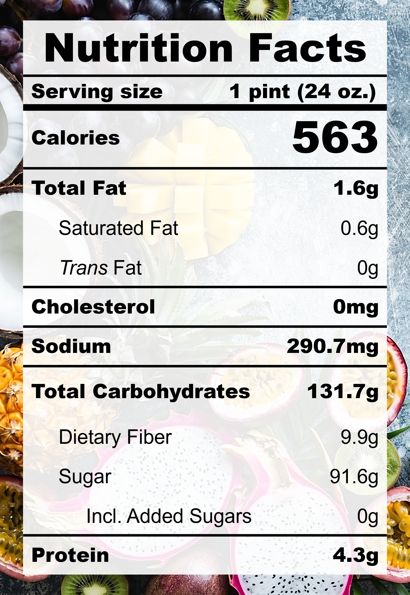

| **Taste** | **Macros** | **Ease** |
| :---: | :---: | :---: |
| ★★★★☆ | ★☆☆☆☆ | ★★★★★ | 

## Recipe

**Ingredients for a 24-oz pint:**
- Bananas (5 medium / 580 g)
- Salt (&frac18; tsp)

**Instructions:**
1. Mix bananas and salt together.
2. Freeze for 24 hours.
3. Spin on SORBET (push down and re-spin if needed).

## Nutrition Facts

## Reflections

**Overall Rating:** ★★★★☆

Wow-o-wow! Who knew that bananas were such an ice cream super-ingredient with its sweetness, fragrance, body, and rich creaminess. The salt works wonders to balance the flavour depth and create the perfect salty-sweet pint.

**The Good (what went well):**
- Easiest recipe ever: It doesn't get better than this! This is a very beginner friendly recipe that's also super delicious.

**The Bad (lessons learned):**
- Slightly alcohol taste: The bananas were quite browned. The banana ripeness needs to be just right to get the perfect sweetness without over-fermentation.
- Flat flavour profile: A tad more salt would help the overall flavour depth.

