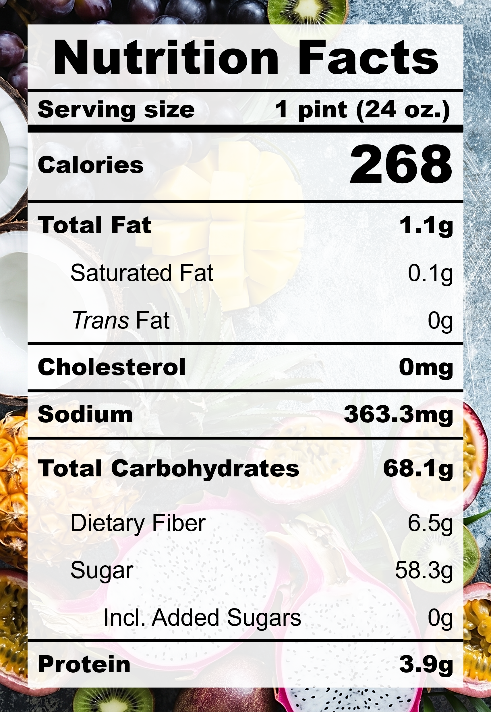

| **Taste** | **Macros** | **Ease** |
| :---: | :---: | :---: |
| ★★★☆☆ | ★★☆☆☆ | ★★★★☆ | 

## Recipe

**Ingredients for a 24-oz pint:**
- Peaches, white (430 g)
- Coconut water (280 ml)
- Honey (1 tbsp)
- Salt (&frac18; tsp)
- Lemon juice (2 tsp)

**Instructions:**
1. Blend everything together.
2. Freeze for 24 hours.
3. Spin on SORBET (push down and re-spin if needed).

## Nutrition Facts

## Reflections

**Overall Rating:** ★★★★☆

I was very inspired by the mounds of ripe stone fruits at the farmer's market and wanted to capture the taste of a juicy sweet peach in sorbet form. This was a super refreshing and light dessert, but its taste and texture could be improved.

**The Good (what went well):**
- Sweet peachy fragrance: The peachy sweetness literally radiates from the fruit. Pick the ripe ones that smell delicious!

**The Bad (lessons learned):**
- Slushy texture: There's a lot of water in peaches and not enough solids in the pint to hold the texture. Boiling down the peaches or adding more body would help.
- Not sweet enough: This is up to personal preference, but I would add some more sugar next time to boost the peach's nature sweetness.

